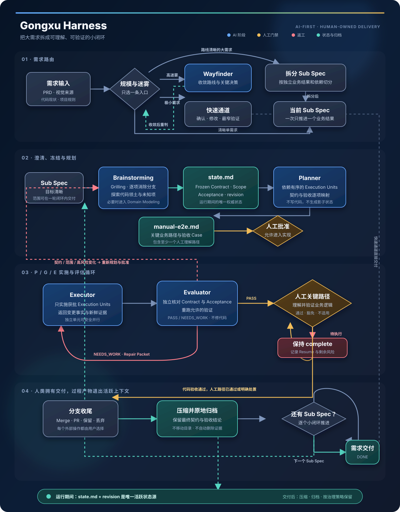

# 工序（Gongxu）

> 面向中文企业研发场景的 AI-first 工程 Harness。把大需求拆成可理解、可验证的
> 小闭环，在人机协作中完成规划、实施、独立评估与人工验收。

Gongxu is a provider-neutral, enterprise-grade AI engineering workflow harness for
resumable planning, execution, independent evaluation, and human acceptance.

[](https://github.com/gnahzil/gongxu/actions/workflows/ci.yml)
[](https://github.com/gnahzil/gongxu/actions/workflows/secret-scan.yml)
[](./package.json)
[](./LICENSE)

## 1. 为什么是 Gongxu

AI 写代码已经很快。真正困难的是：在一项持续数天、跨越多个模块的需求里，让 AI
始终知道要解决什么、边界在哪里，以及由谁判断工作已经完成。

Gongxu 围绕这个问题做了几项明确取舍。

### 1.1 文档服务于执行

`state.md`、`manual-e2e.md` 和过程证据用于恢复上下文、约束实现和支撑验收。它们是
研发过程中的脚手架，不是最终产品。需求交付后，Gongxu 会压缩并归档这些产物，使其
退出活跃上下文；代码、必要测试、领域语言、ADR 和用户文档继续承担长期知识。归档周期由
项目的审计、合规和知识管理要求决定。

### 1.2 不把 TDD 当成默认答案

测试有价值，但测试先行不应成为 AI 开发的固定仪式。Agent 很容易把大量上下文和
Token 消耗在测试脚手架、Mock 与局部实现上，却没有同步提高对完整业务结果的理解。
Gongxu 先冻结业务契约，再按风险运行 targeted tests，通过独立评估和人工验收确认
交付质量。项目仍可按自己的测试策略覆盖这一默认选择。

### 1.3 人必须理解自己交付的系统

Gongxu 不追求让人退出开发过程。人在需求访谈、方案取舍和返工判断中持续参与，逐步
建立对业务链路的理解。交付前，人应亲自验证关键业务路径，并能够解释系统为什么这样
工作。自动检查负责可重复的技术验证，人工测试负责业务语义和真实使用场景。

### 1.4 把大需求变成小闭环

AI 在边界清晰、反馈周期短的任务上更可靠。需求越大，决策分支、上下文和跨模块依赖
越多，漂移与返工的概率越高。Gongxu 先消除迷雾，再按独立业务结果拆分 Sub Spec。
每个 Sub Spec 都完整经历澄清、规划、实现和评估，通过多个小闭环逐步收敛整个需求。

### 1.5 从成熟实践出发，适配中文企业研发

Gongxu 受到 [`obra/superpowers`](https://github.com/obra/superpowers)、
[`jnMetaCode/superpowers-zh`](https://github.com/jnMetaCode/superpowers-zh) 和
[`mattpocock/skills`](https://github.com/mattpocock/skills) 启发，但不是简单翻译。
它针对中文研发沟通、跨服务协作、人工审批、业务异常、数据脱敏、测试职责和审计归档
重新设计。核心保持 provider-neutral，项目差异通过 Profile 与 Extra 扩展。

## 2. Harness 如何工作



主路径从需求澄清开始。高迷雾需求先进入 Wayfinder，大需求按独立业务结果拆成多个
Sub Spec。每个 Sub Spec 都拥有自己的 `state.md`，依次经过 Planner、Executor 和
Evaluator。Evaluator 发现问题就把结构化修复清单交回 Executor；契约或范围变化则
退回规划并重新获得批准。代码验收通过后，人亲自验证关键业务路径，最后完成分支处理
并将过程产物压缩归档。

图中蓝色节点由 AI 主导，金色节点需要人作出决定，红色路径表示返工，青绿色表示状态
与归档。可编辑的 Mermaid 源文件见
[`docs/assets/gongxu-harness.mmd`](./docs/assets/gongxu-harness.mmd)。

实现阶段由主 Agent 调度 Executor，Executor 不再嵌套分派实现 Agent。只有 Execution
Units 的文件范围、可变运行时资源和依赖都独立，并且每个 writer 都能获得基于同一已提交
基线的隔离工作区时，才会并行写代码；否则顺序执行。平台没有原生隔离能力时，可启用
`using-git-worktrees` Extra。Gongxu 不会把“缺少隔离”静默降级成共享目录并行写。

## 3. 安装

前置要求：Node.js 20 或更高版本、Git，以及受支持 Agent 的项目级配置权限。请在需要
接入 Gongxu 的目标项目根目录执行以下命令。

```bash
npx gongxu@latest add
npx gongxu@latest add --agent codex --profile mysql-strict
npx gongxu@latest add --extra using-git-worktrees
```

默认安装 11 个核心 Skill、核心规则和 Claude Code、Codex 适配，不启用任何可选项。

Profile 用于规则覆盖：

- `mysql-strict`：精确 MySQL DDL 约束；
- `human-owned-testing`：测试修改与执行由用户负责。

Extra 直接使用 Skill 名称：

- `using-git-worktrees`：安全创建交互式或并行编排使用的隔离 Git worktree；
- `writing-design-doc`：从冻结状态导出人类评审技术设计；
- `production-incident-triage`：生产事故只读取证与脱敏报告；
- `chinese-commit-conventions`：生成或检查中文 Conventional Commit。

```bash
npx gongxu@latest profile list
npx gongxu@latest profile enable human-owned-testing
npx gongxu@latest extra list
npx gongxu@latest extra enable writing-design-doc
npx gongxu@latest extra disable writing-design-doc
```

`profile` 和 `extra` 的 enable/disable 会在同一事务中更新配置并同步受管理文件，只删除
未修改的旧文件；本地修改会停止并报告冲突。使用任意 Git 或本地安装源时，修改可选项
需用 `--source <source>` 再次提供来源。`--force` 会先备份再覆盖。未启用 Extra 时，
Gongxu 不会自动修改配置或静默降级。

## 4. 配置与工作区

安装总会生成可安全提交的 `.gongxu/config.json`，包含 schema、启用的 Profiles 与
Extras、`artifactRoot`、`sourceRoots`、视觉 provider、测试策略和
Planner/Executor/Evaluator 模型覆盖。默认视觉 provider 与模型均为 `auto`；
targeted tests 可自动运行，full suite 先询问。默认 artifact root 为 `docs/gongxu`。

工作区依次从 Gongxu 配置、Git root、cwd 解析，支持单仓库和 monorepo。可选本机
上下文模板安装到 `.gongxu/templates/context.local.md.example`；实际
`.gongxu/context.local.md` 不会自动创建且必须忽略，禁止存放秘密或复制到公共输出。

## 5. 更新、来源安全与检查

```bash
npx gongxu@latest update
npx gongxu@latest doctor
```

内置 npm 来源和严格 `owner/repo[#ref]` GitHub 标识可安全记录。任意 HTTPS、SSH、
`git@` 来源只在运行时使用，manifest 仅记录不含域名和路径的 `git`，更新时必须再次
提供来源。本地路径同样不持久化。明文 HTTP 来源会被拒绝；HTTPS URL 的 userinfo、
query 或 fragment 也会被拒绝。Git 错误不会回显来源、凭据或远端 stderr。

`doctor` 校验配置、manifest、核心文件、已启用 Profile 和 Extra，并提示尚待 `update`
的配置差异。安装器不会自行 commit、push、发布或配置远程。

## 6. 测试与验证

默认允许 Agent 修改相关测试并自动运行最窄 targeted tests；full suite、生产、
破坏性、付费、外部或敏感测试需确认。`human-owned-testing` Profile 会恢复全面人工
负责策略。静态检查不得冒充测试证据。

本仓库开发验证：

```bash
npm test
npm run check
npm pack --dry-run --json
```

## 7. 隐私、视觉与故障报告

视觉契约不绑定 provider；提供 Figma 来源时自动选择 Figma adapter，配置可覆盖。
非 UI 任务不受影响；缺 verifier 会被明确记录为证据缺口。启用
`production-incident-triage` 后，生产故障的脱敏报告位于解析后的
`<artifactRoot>/triage/`，原始证据仅放忽略的 `.gongxu/triage-private/`。

不要提交真实秘密、私有上下文、内部 URL 或生产数据。任意 Git 来源也不会持久化
端点。安全问题见 [`SECURITY.md`](./SECURITY.md)。

## 8. 项目与许可证

仓库：<https://github.com/gnahzil/gongxu>；维护者 handle：`gnahzil`。

Gongxu contributors 创作的内容及已标识的 MIT 衍生内容按各自许可提供。第三方项目
归属和许可文本见 [`THIRD_PARTY_NOTICES.md`](./THIRD_PARTY_NOTICES.md)。

Claude、Claude Code、Anthropic、Codex、OpenAI、GitHub、GitLab 及其他产品或公司
名称可能是其各自权利人的商标。提及仅用于说明兼容性，不表示隶属、赞助或背书。
